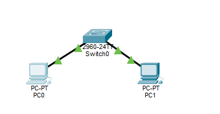

# Cisco Packet Tracer – Small Office LAN Project

## Project Overview
Designed and configured a small Local Area Network (LAN) using Cisco Packet Tracer. The objective was to connect two computers through a Cisco 2960 switch and verify network communication.
## Network Topology

## Tools and Equipment
- Cisco Packet Tracer
- Cisco 2960-24TT Switch
- 2 PC-PT Computers
- Copper Straight-Through Ethernet Cables

## IP Addressing
| Device | IP Address | Subnet Mask |
|---|---|---|
| PC0 | 192.168.1.10 | 255.255.255.0 |
| PC1 | 192.168.1.20 | 255.255.255.0 |

## Implementation
1. Created the network topology.
2. Connected both PCs to the switch.
3. Assigned static IPv4 addresses.
4. Configured subnet masks.
5. Tested connectivity using ping.

## Testing and Results
Command: `ping 192.168.1.20`

- Packets sent: 4
- Packets received: 4
- Packet loss: 0%
- Average round-trip time: 1 ms

## Skills Demonstrated
- LAN configuration
- IPv4 addressing
- Ethernet connectivity
- Network connectivity testing
- Cisco Packet Tracer

## Conclusion
Successfully demonstrated connectivity between two computers on the same subnet. This is my first practical networking project as an IT Networking and Cybersecurity student.
